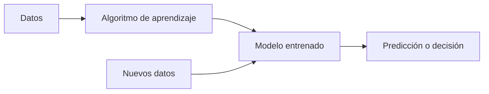
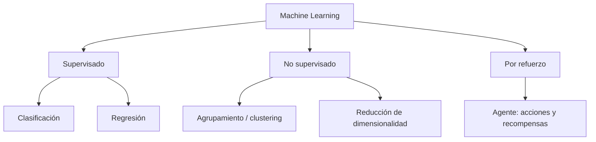
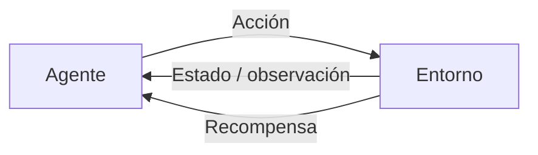
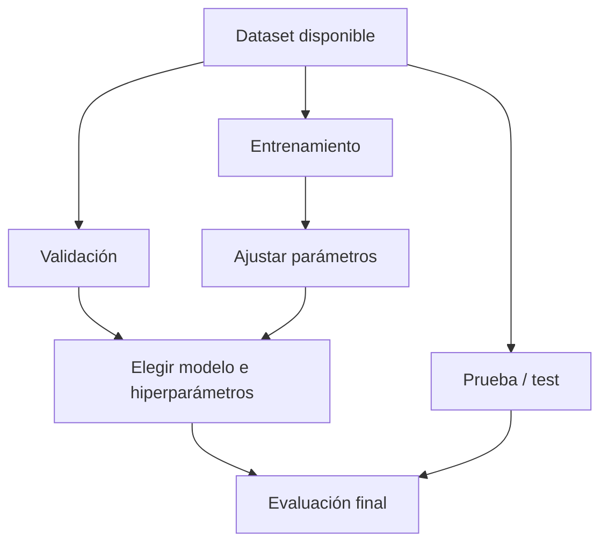
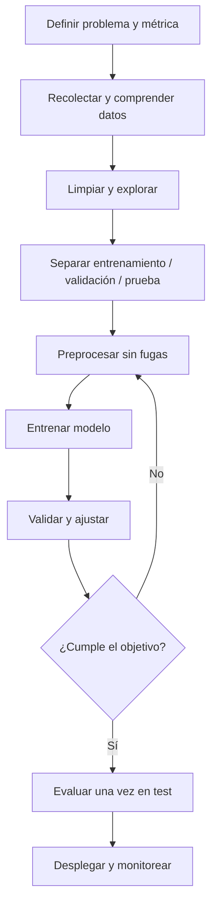
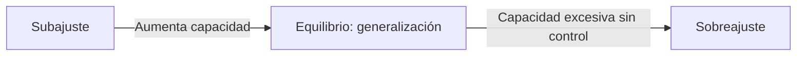

# Machine Learning — Fundamentos y flujo de trabajo

> [!abstract] Objetivo
> Comprender qué es el aprendizaje automático, sus paradigmas, los tipos de datos, el entrenamiento y la evaluación de modelos, y cómo identificar el sobreajuste. Esta nota reorganiza y complementa los apuntes de clase.

## 1. ¿Qué es Machine Learning?

**Machine Learning (ML)** o *aprendizaje automático* es una rama de la inteligencia artificial que construye modelos capaces de **aprender patrones a partir de datos** para realizar predicciones, clasificaciones o tomar decisiones sobre ejemplos nuevos.

En vez de escribir manualmente todas las reglas, proporcionamos ejemplos y un algoritmo ajusta los parámetros de un modelo.

**Ejemplo: filtro de spam.** Un modelo observa correos etiquetados como *spam* o *no spam* y aprende regularidades que después aplica a correos desconocidos. No basta con memorizar palabras: el objetivo es **generalizar**.

### ML frente a Deep Learning

| Machine Learning tradicional | Deep Learning |
|---|---|
| Incluye regresión, árboles, SVM, k-NN, etc. | Usa redes neuronales de múltiples capas |
| A menudo requiere diseñar características | Puede aprender representaciones complejas automáticamente |
| Puede funcionar muy bien con datos tabulares relativamente pequeños | Suele beneficiarse de muchos datos y capacidad de cómputo |
| No siempre es interpretable | A menudo es más difícil de interpretar |

> [!important] Relación
> **Deep Learning es un subconjunto de Machine Learning**, no su opuesto. Las redes neuronales también pueden usarse fuera del aprendizaje profundo.

## 2. Principales paradigmas de aprendizaje

### 2.1. Aprendizaje supervisado

El conjunto de entrenamiento contiene **entradas y respuestas conocidas** (*etiquetas*). Se busca aprender una función aproximada:

$$\hat y=f_\theta(\mathbf{x})$$

- $\mathbf{x}$: características de entrada.
- $y$: respuesta verdadera.
- $\hat y$: predicción del modelo.
- $\theta$: parámetros aprendidos.

**Clasificación:** predice una **categoría**. Ejemplos: correo *spam/no spam*, diagnóstico por categorías, reconocimiento de dígitos.

**Regresión:** predice un **valor numérico**, normalmente continuo. Ejemplos: precio de una casa, temperatura o demanda futura.

> [!warning] Corrección importante
> La regresión **no** es un tipo de aprendizaje no supervisado: habitualmente es **supervisada**. Tampoco debe confundirse la regresión predictiva con la regresión logística, que se usa comúnmente para **clasificación**.

### 2.2. Aprendizaje no supervisado

Trabaja con entradas **sin etiquetas de respuesta**. Intenta descubrir estructuras en los datos.

- **Clustering:** agrupa observaciones similares, por ejemplo mediante *k-means*.
- **Reducción de dimensionalidad:** representa los datos usando menos variables, por ejemplo mediante PCA.
- **Detección de anomalías:** identifica casos poco habituales (puede plantearse con métodos supervisados, no supervisados o semisupervisados).

**Ejemplo:** agrupar clientes según patrones de compra sin disponer de grupos predefinidos.

### 2.3. Aprendizaje por refuerzo

Un **agente** interactúa con un **entorno**, elige acciones y recibe recompensas. Aprende una política que busca maximizar la recompensa acumulada.

Ejemplos: control robótico, videojuegos y planificación secuencial. No consiste simplemente en responder preguntas correctamente; importa la **secuencia de decisiones**.

## 3. Datos: ejemplos, características y etiquetas

Un dataset tabular puede representarse así:

| Horas de estudio ($x_1$) | Ejercicios resueltos ($x_2$) | Aprobó ($y$) |
|---:|---:|---|
| 2 | 10 | No |
| 5 | 35 | Sí |
| 3 | 18 | No |
| 7 | 60 | Sí |

Cada **fila** es un ejemplo; cada **columna de entrada** es una característica (*feature*); $y$ es la etiqueta u objetivo (*target*). En una tarea no supervisada no hace falta una columna $y$.

Si tenemos $n$ observaciones y $d$ características:

$$X\in\mathbb{R}^{n\times d},\qquad \mathbf{y}\in\mathbb{R}^{n}$$

En clasificación, las etiquetas pueden ser categorías y no necesariamente números reales.

### Datos de entrenamiento, validación y prueba

- **Entrenamiento:** el modelo aprende parámetros a partir de estos ejemplos.
- **Validación:** sirve para comparar modelos, ajustar hiperparámetros y tomar decisiones durante el desarrollo.
- **Prueba:** se reserva para estimar el rendimiento final sobre datos no utilizados para entrenar ni seleccionar el modelo.

Una partición **80 % / 10 % / 10 %** es una opción ilustrativa, **no una regla universal**. También se utiliza validación cruzada, especialmente con datasets pequeños.

> [!danger] Fuga de información (*data leakage*)
> Si se usan los datos de prueba para elegir el modelo, o se calcula un preprocesamiento con información de todo el dataset antes de dividirlo, la evaluación puede resultar artificialmente optimista.

## 4. Flujo completo de un proyecto de ML

1. **Definir el problema:** ¿clasificar, predecir un número, agrupar o decidir acciones?
2. **Entender los datos:** procedencia, calidad, valores faltantes, sesgos y etiquetas.
3. **Preprocesar:** tratar faltantes, codificar categorías y escalar variables cuando el algoritmo lo requiera.
4. **Entrenar:** ajustar parámetros minimizando una función de pérdida.
5. **Validar:** comparar configuraciones e identificar problemas.
6. **Evaluar:** medir el rendimiento final en datos reservados.
7. **Usar y monitorear:** observar errores y cambios en los datos reales.

### ¿Qué significa entrenar matemáticamente?

Para un modelo parametrizado por $\theta$, se minimiza una pérdida promedio:

$$\theta^*=\arg\min_{\theta}\frac1n\sum_{i=1}^{n}L\big(f_\theta(\mathbf{x}_i),y_i\big)$$

Por ejemplo, en regresión lineal:

$$\hat y=wx+b,\qquad L(\hat y,y)=(\hat y-y)^2$$

El **descenso de gradiente** actualiza los parámetros mediante:

$$\theta_{t+1}=\theta_t-\eta\nabla_\theta J(\theta_t)$$

Aquí $\eta$ es la **tasa de aprendizaje** (*learning rate*) y $J$ es la función objetivo. Algunos modelos, como ciertos árboles de decisión, se entrenan con otros procedimientos.

## 5. Evaluación: ¿qué tan bien funciona el modelo?

### Clasificación

| Métrica | Fórmula | Qué mide |
|---|---|---|
| Exactitud (*accuracy*) | $\frac{TP+TN}{TP+TN+FP+FN}$ | Proporción de predicciones correctas |
| Precisión (*precision*) | $\frac{TP}{TP+FP}$ | De los positivos predichos, cuántos lo son |
| Sensibilidad (*recall*) | $\frac{TP}{TP+FN}$ | De los positivos reales, cuántos detecta |
| F1 | $2\frac{PR}{P+R}$ | Balance armónico entre precisión y recall |

$TP$: verdadero positivo; $TN$: verdadero negativo; $FP$: falso positivo; $FN$: falso negativo.

> [!example] Atención al desbalance
> Si el 99 % de los correos no es spam, un clasificador que siempre responde «no spam» obtiene 99 % de *accuracy* y aun así **no detecta ningún spam**. La métrica depende del objetivo.

### Regresión

**Error absoluto medio (MAE):**

$$\operatorname{MAE}=\frac1n\sum_{i=1}^{n}|y_i-\hat y_i|$$

**Error cuadrático medio (MSE):**

$$\operatorname{MSE}=\frac1n\sum_{i=1}^{n}(y_i-\hat y_i)^2$$

El MSE penaliza más los errores grandes. No existe una única métrica correcta para todos los problemas.

## 6. Sobreajuste (*overfitting*) y subajuste (*underfitting*)

**Sobreajuste:** el modelo aprende peculiaridades y ruido del entrenamiento, pero falla al generalizar. Puede lograr un error muy bajo en entrenamiento y alto en validación o prueba.

**Subajuste:** el modelo es demasiado limitado o está insuficientemente entrenado; falla incluso con los datos de entrenamiento.

| Situación | Error de entrenamiento | Error de validación |
|---|---|---|
| Subajuste | Alto | Alto |
| Buen ajuste | Bajo | Bajo y cercano al de entrenamiento |
| Sobreajuste | Muy bajo | Sensiblemente mayor |

Estas son tendencias orientativas, no criterios infalibles.

### Cómo reducir el sobreajuste

- Obtener más datos **representativos** y de calidad, cuando sea viable.
- Reducir complejidad o seleccionar características relevantes.
- Aplicar regularización, como L1 o L2.
- Usar validación cruzada y ajustar hiperparámetros con cuidado.
- En redes neuronales, considerar *dropout*, *data augmentation* o *early stopping*, según el problema.
- Verificar que no exista fuga de información.

> [!tip] Idea esencial
> **No se trata de memorizar las respuestas: se trata de aprender patrones que funcionen en datos nuevos.**

## 7. Miniresumen para repasar

| Concepto | Pregunta clave |
|---|---|
| Supervisado | ¿Tengo la respuesta correcta de los ejemplos? |
| No supervisado | ¿Busco patrones sin etiquetas? |
| Refuerzo | ¿Aprendo mediante acciones y recompensas? |
| Clasificación | ¿Predigo categorías? |
| Regresión | ¿Predigo números? |
| Entrenamiento | ¿Dónde se ajustan los parámetros? |
| Validación | ¿Dónde elijo y ajusto el modelo? |
| Prueba | ¿Dónde estimo el rendimiento final? |
| Sobreajuste | ¿Memoricé particularidades y fallé en ejemplos nuevos? |
| Subajuste | ¿El modelo ni siquiera aprendió suficientemente el entrenamiento? |

## 8. Preguntas de autoevaluación

1. ¿Por qué la clasificación de spam es supervisada?
2. ¿Cuál es la diferencia entre una característica y una etiqueta?
3. ¿Por qué no debemos seleccionar hiperparámetros usando el conjunto de prueba?
4. ¿Cómo reconocerías un sobreajuste observando dos errores?
5. ¿Por qué un 99 % de exactitud puede ser engañoso?
6. ¿Qué relación tiene el gradiente con el aprendizaje de parámetros?
7. ¿Cuándo preferirías regresión frente a clasificación?

## 9. Glosario rápido

- **Dataset:** conjunto de datos.
- **Feature:** característica de entrada.
- **Label / target:** respuesta objetivo.
- **Modelo:** función aprendida que produce predicciones.
- **Parámetro:** valor ajustado durante el entrenamiento.
- **Hiperparámetro:** configuración elegida externamente, como profundidad máxima o tasa de aprendizaje.
- **Generalización:** buen desempeño sobre ejemplos no vistos.
- **Inferencia:** uso de un modelo entrenado para producir una predicción.
- **Época (*epoch*):** una pasada por los datos de entrenamiento, concepto frecuente en entrenamiento iterativo.

## 10. Para profundizar

- [Guía de usuario de scikit-learn](https://scikit-learn.org/stable/user_guide.html)
- [Google Machine Learning Crash Course](https://developers.google.com/machine-learning/crash-course)
- [Documentación de PyTorch](https://pytorch.org/tutorials/)

---

